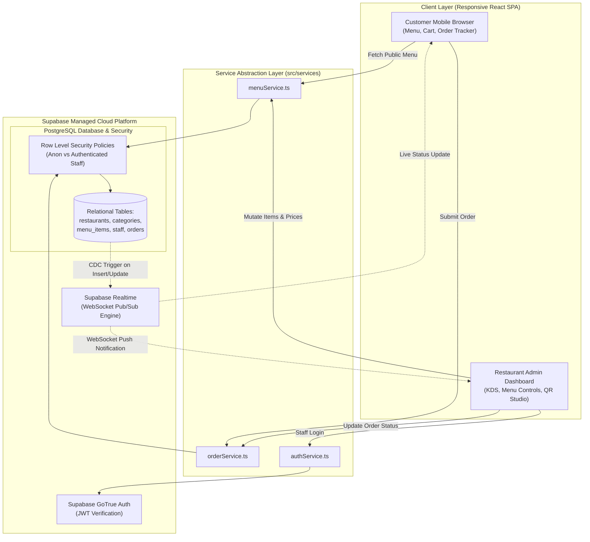

# DineFlow

> **Digital Ordering and Restaurant Management Platform for Local Restaurants**

---

## 1. Project Title and Tagline

- **Project Title**: **DineFlow**
- **Tagline**: Empowering local restaurants with zero-friction digital ordering, real-time kitchen operations, and instant menu agility.
- **Repository**: `https://github.com/your-organization/dineflow` *(Placeholder)*
- **Live Demo**: `https://dineflow.vercel.app` *(TBD upon deployment)*

---

## 2. Project Overview

**DineFlow** is an open, modern, web-first ordering and restaurant operations platform engineered specifically for independent and local dining establishments. By eliminating the necessity for costly proprietary POS hardware and removing the barrier of native app downloads for patrons, DineFlow enables diners to scan a table-specific QR code, explore categorized menus, customize their selections, and submit orders directly via their smartphone browser.

Concurrently, restaurant staff manage incoming tickets through a web-based Kitchen Display System (KDS) powered by Supabase Realtime WebSockets, updating preparation stages and toggling menu item availability on the fly.

---

## 3. Problem Statement

Local dining establishments operate under constrained profit margins and limited technical infrastructure:

- **Prohibitive Hardware & Software Costs**: Enterprise POS ecosystems (such as Toast, Micros, or Clover) impose thousands of dollars in proprietary hardware purchases and rigid multi-year licensing subscriptions.
- **Diner Friction**: Requiring patrons to download mobile apps or register accounts introduces conversion drops exceeding 60% at the table.
- **Inefficient Communication**: Physical paper menus become obsolete the moment an ingredient runs out (86'd items), forcing waitstaff into time-consuming verbal explanations.
- **Peak-Hour Bottlenecks**: Wait times surge during rush periods because staff must split time between order-taking, payment processing, and food delivery.

---

## 4. Problem Being Solved

DineFlow resolves these operational bottlenecks by:
1. Transforming any standard browser on a patron's existing smartphone into a zero-install digital ordering terminal via dynamic QR codes.
2. Automating ticket transmission straight to kitchen screens using instantaneous WebSocket streaming.
3. Enabling instant menu updates (pricing adjustments, marking dishes sold out) without reprinting physical collateral.
4. Operating on a lightweight, serverless cloud architecture that can be hosted with minimal overhead.

---

## 5. Proposed Solution

The DineFlow solution comprises a unified web application serving two distinct personas:

```
+------------------------------------------------------------------------------------------+
|                                        DineFlow                                          |
+------------------------------------------------------------------------------------------+
|                                                                                          |
|     +----------------------------------+        +----------------------------------+     |
|     |       Customer Mobile App        |        |     Restaurant Admin Dashboard   |     |
|     +----------------------------------+        +----------------------------------+     |
|     | - QR table resolution            |        | - Secure staff authentication    |     |
|     | - Filterable categorized menu    |        | - Live KDS order feed (Realtime) |     |
|     | - Dietary & price transparency   |        | - One-click ticket status update |     |
|     | - Client-cached shopping cart    |        | - Instant menu stock (86) toggle |     |
|     | - Dine-in / Takeaway selection   |        | - Table QR code generator        |     |
|     | - Real-time order receipt view   |        | - Basic operations analytics     |     |
|     +----------------------------------+        +----------------------------------+     |
|                       \                                      /                           |
|                        \                                    /                            |
|                         v                                  v                             |
|               +------------------------------------------------------+                   |
|               |        Supabase Managed Backend & Services           |                   |
|               |  (PostgreSQL, Row Level Security, Realtime Engine)   |                   |
|               +------------------------------------------------------+                   |
+------------------------------------------------------------------------------------------+
```

---

## 6. Target Users

| Target User Group | Context of Use | Primary Needs | Delivered Value |
| :--- | :--- | :--- | :--- |
| **Dine-In Patrons** | Seated at dining tables in the restaurant | Fast access to food listings, allergen tags, and instant order placement. | No waiting for physical menus; transparent prices; zero app installation. |
| **Takeaway Customers** | Ordering from counter or curbside | Quick item selection, clear order tracking ID, and takeaway designation. | Skips long counter queues and eliminates order miscommunication. |
| **Kitchen & Floor Staff** | Behind the counter or in the food preparation area | Legible, chronological, color-coded ticket feed with dietary notes. | Real-time ticket alerts without manual paper ticket routing. |
| **Restaurant Owners / Managers** | Managing daily inventory and floor tables | Quick 86'ing of sold-out items, price tuning, and printing QR stands. | Agile menu governance without reprint expenditures. |

---

## 7. Key Features

> **Implementation Status Legend**: All features are currently designated as `[ ] Planned` pending feature implementation sprints.

### Customer Interface
- [ ] **Planned**: Dynamic QR table code parameter parsing (`/?restId=...&table=...`).
- [ ] **Planned**: Categorized menu navigation with search filtering and Veg/Non-Veg badges.
- [ ] **Planned**: Item customization with special preparation notes (e.g., "no onions").
- [ ] **Planned**: Interactive sliding shopping cart with client-side persistence (`localStorage`).
- [ ] **Planned**: Fulfillment selector: Dine-In (table pre-filled) vs. Takeaway.
- [ ] **Planned**: Instant order submission with input validation.
- [ ] **Planned**: Live order confirmation receipt with real-time status tracker.

### Restaurant Admin Dashboard
- [ ] **Planned**: Secure staff authentication via Supabase Auth (email/password).
- [ ] **Planned**: Kitchen Display System (KDS) with color-coded Kanban ticket progression.
- [ ] **Planned**: Sub-second real-time order arrival via Supabase WebSocket subscriptions.
- [ ] **Planned**: Single-tap lifecycle status transitions (`pending` -> `preparing` -> `ready` -> `completed` / `cancelled`).
- [ ] **Planned**: Menu management view with one-click availability toggle (86'd stock switch).
- [ ] **Planned**: In-line price and item description editor.
- [ ] **Planned**: Printable table QR code generator with SVG/PNG download.
- [ ] **Planned**: Operational dashboard summary (Daily revenue total, active order counter).

---

## 8. Customer Application Workflow

| Step | Action | User Interface / Interaction | System Response |
| :---: | :--- | :--- | :--- |
| **1** | **Scan QR Code** | Diner scans physical QR code on table using phone camera | Browser opens `https://.../?table=4`, resolving restaurant & table ID |
| **2** | **Browse Menu** | Customer scrolls categories, searches dishes, toggles veg filter | UI queries cached menu; items display prices, photos, and descriptions |
| **3** | **Customize & Add** | Customer clicks item, specifies special requests, adds to cart | Item appended to cart state; running total updates instantly |
| **4** | **Review Cart** | Customer opens cart drawer, verifies quantities and table number | Subtotal calculated; prompt validates name and dining mode |
| **5** | **Submit Order** | Customer taps "Place Order" button | Payload dispatched to `orderService.createOrder`; record created in Supabase |
| **6** | **Receipt & Track**| Customer redirected to `/order/:orderId` | Dynamic receipt rendered; live status reflects kitchen progress |

---

## 9. Restaurant Dashboard Workflow

| Step | Action | Staff Interface / Interaction | System Response |
| :---: | :--- | :--- | :--- |
| **1** | **Staff Login** | Staff member inputs credentials at `/admin/login` | Supabase Auth validates session JWT; redirects to KDS `/admin/orders` |
| **2** | **Listen for Orders**| KDS dashboard remains active on kitchen tablet/monitor | Realtime subscription listens on PostgreSQL `INSERT` events |
| **3** | **Order Arrival** | New ticket appears with visual alert showing table number and items | Order card rendered in the "Pending" column |
| **4** | **Preparation** | Staff taps "Start Preparing" on the ticket | Order status updated to `preparing`; syncs back to customer view |
| **5** | **Ready for Pickup** | Kitchen marks dish "Ready"; staff delivers to designated table | Status shifts to `ready`, notifying floor staff / customer |
| **6** | **Fulfillment** | Staff marks ticket "Completed" | Order archived from active KDS feed into daily analytics |
| **7** | **Inventory Control**| Manager navigates to `/admin/menu` to disable sold-out dishes | `is_available` flag set to `false`; item instantly disabled on public menu |

---

## 10. Technology Stack with Explanations

| Category | Technology | Version | Purpose & Rationale |
| :--- | :--- | :--- | :--- |
| **Frontend Framework** | React | `^18.3.1` / `^19.0.0` | Industry-standard declarative component architecture for dynamic interfaces. |
| **Language** | TypeScript | `^5.0.0` | Comprehensive type safety, preventing runtime errors across contracts and state. |
| **Build Tool** | Vite | `^6.0.0` | High-performance bundling and sub-second Hot Module Replacement (HMR). |
| **CSS Framework** | Tailwind CSS | `^3.4.0` | Utility-first styling framework enabling rapid, responsive UI development. |
| **Database** | PostgreSQL (Supabase) | `15.x` | Enterprise-grade relational database with ACID compliance and JSONB support. |
| **Authentication** | Supabase Auth | Built-in | Secure, token-based session management for restaurant staff accounts. |
| **Realtime Engine** | Supabase Realtime | Built-in | PostgreSQL Change Data Capture (CDC) streaming delta updates over WebSockets. |
| **Iconography** | Lucide React | `latest` | Clean, modern, tree-shakeable icons for actions, badges, and metrics. |
| **QR Code Engine** | `qrcode.react` | `latest` | Client-side generation of high-resolution SVG/Canvas QR codes for tables. |
| **Deployment** | Vercel | Cloud | Edge-optimized continuous integration and zero-configuration hosting. |

---

## 11. System Architecture



---

## 12. Database Overview

DineFlow uses a normalized PostgreSQL schema with Row Level Security (RLS) enabled on all tables:

| Table Name | Primary Purpose | Key Fields | Access Control Summary |
| :--- | :--- | :--- | :--- |
| `restaurants` | Base restaurant identity | `id`, `name`, `slug`, `currency` | Public read; Admin staff write |
| `menu_categories` | Menu groupings (Starters, Mains, etc.) | `id`, `restaurant_id`, `name`, `display_order` | Public read; Admin staff write |
| `menu_items` | Individual dishes and pricing | `id`, `category_id`, `name`, `price`, `is_available` | Public read; Admin staff write |
| `restaurant_staff`| Staff profiles linked to auth accounts | `id`, `user_id`, `restaurant_id`, `role` | Staff self-read; Admin write |
| `orders` | Customer order tickets and status | `id`, `table_number`, `order_type`, `items`, `total_amount`, `status` | Public insert & single read; Staff full management |

*Full schema details, SQL column types, and constraints are documented in [docs/DATABASE.md](docs/DATABASE.md).*

---

## 13. Project Folder Structure

```
DineFlow/
├── README.md                           # Master project documentation
├── AGENTS.md                           # Persistent AI and engineering instructions
├── .gitignore                          # Standardized Git exclusion rules
├── .env.example                        # Template for required environment variables
├── docs/                               # Architecture and specification repository
│   ├── PROBLEM_SCOPE.md                # Scope boundaries, personas, and exclusions
│   ├── ARCHITECTURE.md                 # System blueprints, data flow, and routing
│   ├── DATABASE.md                     # PostgreSQL schema, ERD, and RLS rules
│   ├── API_CONTRACTS.md                # TypeScript models and service signatures
│   ├── TEAM_WORK_SPLIT.md              # 3-person 12-hour hackathon execution roadmap
│   └── DEMO_SCRIPT.md                  # Step-by-step judge demonstration guide
├── public/
│   └── assets/
│       └── images/                     # Static food and brand imagery
├── src/
│   ├── app/                            # Global application wrapper and router
│   ├── components/
│   │   ├── ui/                         # Atomic shared primitives (Button, Modal, Input)
│   │   └── layout/                     # Structural layouts (Navbar, Sidebar, Container)
│   ├── features/
│   │   ├── customer/                   # Customer ordering feature module
│   │   │   ├── components/             # Menu cards, cart sheet, table selector
│   │   │   ├── pages/                  # Menu catalog, checkout, order receipt
│   │   │   ├── hooks/                  # useCart, useMenu, useOrderTracker
│   │   │   └── utils/                  # Price calculations, currency formatters
│   │   └── admin/                      # Restaurant management feature module
│   │       ├── components/             # KDS ticket card, menu table, QR builder
│   │       ├── pages/                  # Staff login, live orders, menu editor
│   │       ├── hooks/                  # useLiveOrders, useMenuManagement, useAdminAuth
│   │       └── utils/                  # Status transition rules, metric calculations
│   ├── services/                       # Centralized Supabase data services
│   ├── types/                          # Canonical TypeScript interfaces and enums
│   ├── styles/                         # Tailwind CSS directives and custom classes
│   └── main.tsx                        # Application mount point
├── supabase/
│   ├── migrations/                     # SQL schema migrations
│   └── seed.sql                        # Demonstration seed dataset
└── tests/
    ├── customer/                       # Customer workflow test suites
    └── admin/                          # Admin dashboard test suites
```

---

## 14. Installation and Setup Instructions

### Prerequisites
- **Node.js**: `v18.x` or `v20.x` LTS
- **npm** (`v9.x`+) or **pnpm**
- A free **Supabase** account (`https://supabase.com`)

### Step-by-Step Setup

1. **Clone the Repository**:
   ```bash
   git clone https://github.com/your-organization/dineflow.git
   cd DineFlow
   ```

2. **Install Dependencies**:
   ```bash
   npm install
   ```

3. **Configure Environment Variables**:
   ```bash
   cp .env.example .env.local
   ```
   Edit `.env.local` with your valid Supabase project credentials (see next section).

4. **Initialize Supabase Database**:
   - Navigate to your Supabase project's SQL Editor.
   - Run the initial schema migration script from `docs/DATABASE.md` (or `supabase/migrations/`).
   - Execute `supabase/seed.sql` to populate sample restaurants, menu categories, and items.

5. **Start Development Server**:
   ```bash
   npm run dev
   ```
   Open `http://localhost:5173` in your browser.

---

## 15. Environment Variable Configuration

Create a `.env.local` file in the project root:

```env
# Supabase API Credentials
VITE_SUPABASE_URL=https://your-project-id.supabase.co
VITE_SUPABASE_PUBLISHABLE_KEY=your-supabase-anon-key
```

> [!CAUTION]
> **Security Guardrail**: Never place the `service_role` secret in client-side environment files. Only the public anonymous key (`VITE_SUPABASE_PUBLISHABLE_KEY`) is permissible in frontend code.

---

## 16. Supabase Configuration Instructions

1. **Create Project**: Sign in to Supabase and create a new project named `dineflow-db`.
2. **Execute Schema**: Open the **SQL Editor** tab and execute the table creation commands outlined in [docs/DATABASE.md](docs/DATABASE.md).
3. **Enable Row Level Security (RLS)**:
   ```sql
   ALTER TABLE restaurants ENABLE ROW LEVEL SECURITY;
   ALTER TABLE menu_categories ENABLE ROW LEVEL SECURITY;
   ALTER TABLE menu_items ENABLE ROW LEVEL SECURITY;
   ALTER TABLE restaurant_staff ENABLE ROW LEVEL SECURITY;
   ALTER TABLE orders ENABLE ROW LEVEL SECURITY;
   ```
4. **Enable Realtime on Orders**:
   ```sql
   ALTER PUBLICATION supabase_realtime ADD TABLE orders;
   ```
5. **Create Staff User**:
   - Go to **Authentication** -> **Users** -> **Add User**.
   - Create a staff user: `manager@bistro.com` with a secure password.
   - Add a corresponding row in `restaurant_staff` mapping their `user_id` to the demo `restaurant_id`.

---

## 17. Development Commands

| Command | Action |
| :--- | :--- |
| `npm run dev` | Starts Vite local development server with Hot Module Replacement |
| `npm run build` | Runs TypeScript compilation (`tsc`) and builds production distribution in `dist/` |
| `npm run preview` | Locally serves the production build from `dist/` |
| `npm run lint` | Analyzes code for stylistic errors and syntax issues |
| `npm run test` | Executes unit and integration test runners |

---

## 18. Team Members and Responsibilities

| Role / Responsibility | Assigned Team Member | Primary Deliverables |
| :--- | :--- | :--- |
| **Lead Architect & Backend Engineer** | Team Member 1 *(Placeholder)* | Supabase schema, RLS policies, Realtime publication, `src/services/*`, `src/types/*` |
| **Customer Experience Engineer** | Team Member 2 *(Placeholder)* | Mobile QR routing, menu browsing, cart state hook, checkout form, order receipt |
| **Admin & Operations Engineer** | Team Member 3 *(Placeholder)* | Staff authentication, live KDS WebSocket dashboard, status transitions, QR studio |

---

## 19. Demonstration Workflow

During hackathon judging, DineFlow is showcased via a synchronized **dual-screen demonstration**:

1. **The Diner Flow (Mobile Viewport)**:
   - Diner visits `/?table=4` (simulating scanning table QR).
   - Category filtering is shown (Mains, Drinks).
   - "Classic Truffle Burger" is added to cart with custom instruction "extra crispy fries".
   - Order is submitted. The customer receives an immediate receipt with status "Pending".
2. **The Kitchen Flow (Laptop KDS Viewport)**:
   - Simultaneously, the KDS screen dynamically pops up the Table 4 ticket via Supabase Realtime without manual browser reload.
   - Staff clicks "Start Preparing"; status updates to "Preparing" on both the KDS and diner screen.
3. **Agile Management**:
   - Manager navigates to `/admin/menu` and toggles the burger to "Unavailable".
   - Menu instantly reflects sold-out status, demonstrating dynamic operational control.

*Refer to [docs/DEMO_SCRIPT.md](docs/DEMO_SCRIPT.md) for the complete presenter narrative.*

---

## 20. Future Improvements

Post-hackathon development roadmap:
- [ ] **Payment Gateway Integration**: Embedded Apple Pay, Google Pay, and Stripe counter checkout.
- [ ] **Hardware Printer Support**: Direct ESC/POS thermal printing for kitchen ticket stations.
- [ ] **Customer Order Memory**: Lightweight phone-number-based lookup for past orders and favorites.
- [ ] **Multi-Location Hierarchy**: Support for restaurant groups with multiple branches and menus.
- [ ] **Audio Chimes**: Customizable audio sounds for new ticket arrivals on the KDS board.

---

## 21. Current Limitations

- **Cash / Counter Settlement**: In the MVP, online payments are simulated; payment settlement occurs in-person at the counter or table.
- **Single Restaurant Tenancy**: The demonstration is optimized for single-restaurant deployment.
- **No Hardware Print Integration**: Orders are displayed purely on digital KDS monitors rather than physical thermal receipt printers.
- **Guest Orders**: Orders do not require patron login; patron identity is tied to the active browser session and generated `order_id`.
