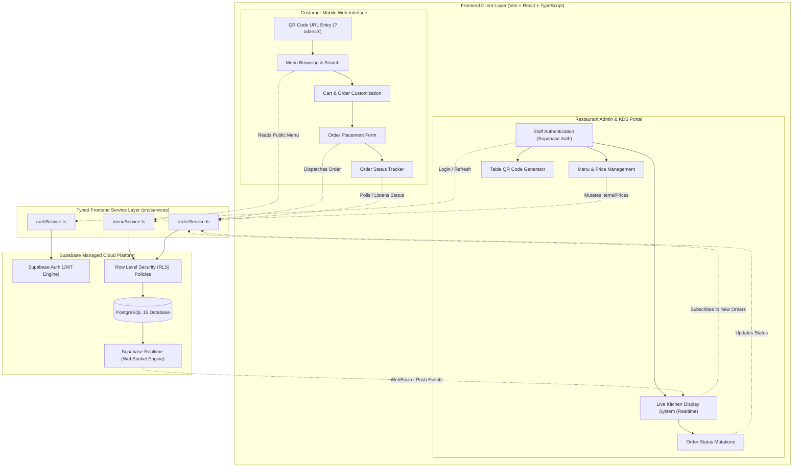
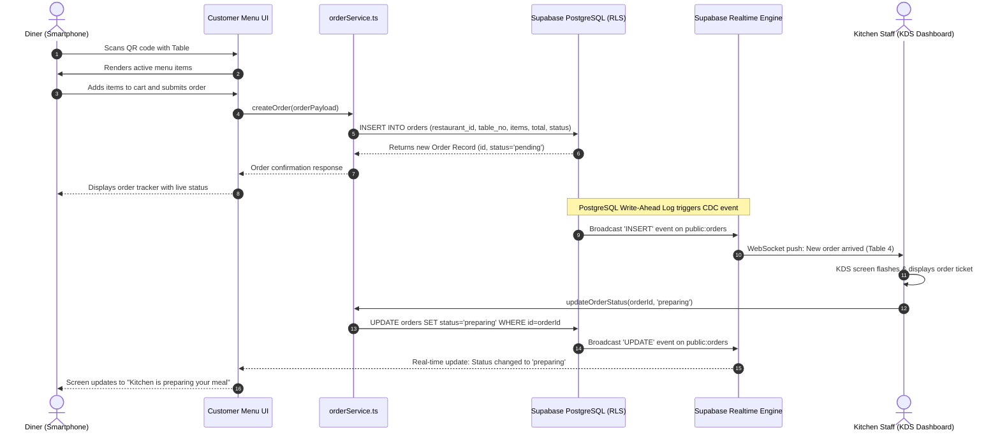

# System Architecture & Technical Design: DineFlow

## 1. Architectural Philosophy

DineFlow employs a modern, serverless single-page application (SPA) architecture designed for high availability, sub-second latency, and rapid real-time synchronization. The platform leverages **React + Vite + TypeScript** on the frontend and **Supabase (PostgreSQL, GoTrue Auth, Realtime Engine)** as a managed Backend-as-a-Service (BaaS).

This architecture eliminates the need for managing a custom Node.js/Express server during a 12-hour hackathon while providing production-grade relational integrity, secure row-level access control, and native WebSocket feeds.

---

## 2. High-Level System Architecture Diagram



---

## 3. Technology Stack & Component Justifications

| Layer | Technology | Justification |
| :--- | :--- | :--- |
| **Framework & Build** | React 18 / Vite / TypeScript | Sub-second HMR development speed, strict type safety, zero build friction for hackathons. |
| **Styling & Design System** | Tailwind CSS | Utility-first styling enables rapid prototyping, responsive layouts, and consistent spacing without CSS bloat. |
| **Icons & Visuals** | Lucide React | Lightweight, tree-shakable icon library matching modern clean dashboard aesthetics. |
| **Database & Persistence**| Supabase PostgreSQL | Full ACID relational database supporting complex joins, structured JSONB schemas, and strict data typing. |
| **Authentication** | Supabase Auth (GoTrue) | JWT-based user session handling for staff; eliminates bespoke hashing and cookie management. |
| **Realtime Engine** | Supabase Realtime (PostgreSQL CDC) | Listens to database `INSERT` and `UPDATE` events on the `orders` table, pushing delta updates to the admin board via WebSockets. |
| **QR Code Engine** | `qrcode.react` / `qrcode` | Client-side SVG/Canvas rendering of restaurant and table-specific access URLs. |
| **Hosting & Deployment** | Vercel | Seamless Git-integrated continuous deployment with automated preview branches and instant edge delivery. |

---

## 4. Application Routing Architecture

The client application is organized into two isolated operational domains driven by a unified router:

```
/                                 -> Customer Home / Menu View (?restId=...&table=...)
/order/:orderId                   -> Customer Order Tracking & Receipt View
/admin/login                      -> Staff Login Portal
/admin/orders                     -> Live Kitchen Display System (KDS) & Order Feed
/admin/menu                       -> Menu Catalog, Stock Availability & Pricing Editor
/admin/qr-generator               -> Table-Specific QR Code Generator & Print Setup
/admin/analytics                  -> Basic Operations & Sales Metrics
```

---

## 5. End-to-End Data Flow

### Customer Order Submission & Real-Time Kitchen Notification



---

## 6. State Management Strategy

To maintain agility and avoid heavy boilerplate (such as Redux), DineFlow adopts a pragmatic, decoupled state strategy:

1. **Cart State (`useCart`)**: Managed via React Context / Custom Hook with browser `localStorage` persistence, enabling shoppers to retain their tray during incidental page reloads.
2. **Server State & Realtime Feeds (`useLiveOrders`)**: Managed via encapsulated hooks that bind Supabase Realtime channel subscriptions on mount and unbind cleanly on unmount, caching active orders in local React state.
3. **Session State (`useAdminAuth`)**: Tracks the authenticated staff JWT session with Supabase Auth listeners (`onAuthStateChange`).
4. **Service Isolation**: All data fetching and mutation functions reside in `src/services/` and return normalized, typed responses:
   ```typescript
   export interface ServiceResponse<T> {
     data: T | null;
     error: string | null;
   }
   ```

---

## 7. Security & Row Level Security (RLS) Architecture

Access to Supabase tables is strictly governed by PostgreSQL Row Level Security:

- **Public Anonymous Role (`anon`)**:
  - `restaurants`: Read-only access to basic restaurant profiles.
  - `menu_categories`: Read-only access to published categories.
  - `menu_items`: Read-only access to items where `is_available = true`.
  - `orders`: Allowed to `INSERT` new orders; allowed to `SELECT` single order details by explicit `order_id` (for the customer receipt view). Cannot update or delete existing orders.
- **Authenticated Staff Role (`authenticated`)**:
  - Full CRUD operations on `menu_items` and `menu_categories` for items belonging to their linked `restaurant_id`.
  - Full read and update permissions on `orders` for their linked `restaurant_id`.
