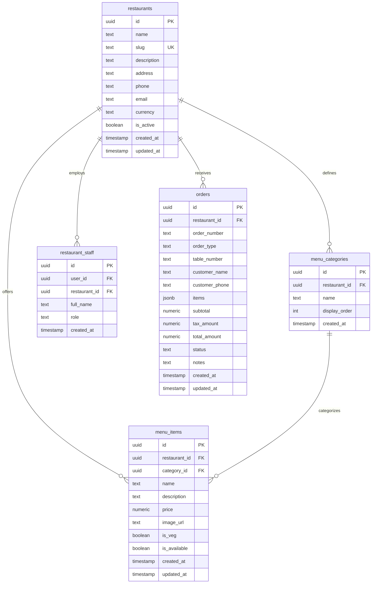

# Database Architecture & Entity Specifications: DineFlow

## 1. Overview & Data Model Design

DineFlow uses **Supabase PostgreSQL** as its relational database. The schema is normalized to ensure relational integrity across multi-table operations, with JSONB optimization for flexible order item snapshots.

The schema comprises five core entities:
1. `restaurants`: Core business profile.
2. `menu_categories`: Groupings for dishes (e.g., Starters, Mains, Drinks).
3. `menu_items`: Individual food and beverage items with pricing and stock availability.
4. `restaurant_staff`: Profile records mapping Supabase Auth users (`auth.users`) to restaurant tenancies.
5. `orders`: Customer orders capturing line items, table number, fulfillment type, and lifecycle state.

---

## 2. Entity-Relationship Diagram (ERD)



---

## 3. Detailed Entity Definitions

### 3.1. `restaurants`
Represents an onboarded restaurant location.

| Column | Type | Constraints | Description |
| :--- | :--- | :--- | :--- |
| `id` | `UUID` | Primary Key, `default gen_random_uuid()` | Unique restaurant identifier |
| `name` | `TEXT` | `NOT NULL` | Business legal/trading name |
| `slug` | `TEXT` | `UNIQUE, NOT NULL` | URL-friendly identifier (e.g., `the-bistro`) |
| `description` | `TEXT` | `NULL` | Business concept / description |
| `address` | `TEXT` | `NULL` | Physical street address |
| `phone` | `TEXT` | `NULL` | Contact telephone number |
| `email` | `TEXT` | `NULL` | Contact email address |
| `currency` | `TEXT` | `DEFAULT 'USD', NOT NULL` | Currency symbol/code (`USD`, `EUR`, `INR`, etc.) |
| `is_active` | `BOOLEAN` | `DEFAULT true, NOT NULL` | Operating status flag |
| `created_at` | `TIMESTAMPTZ` | `DEFAULT now(), NOT NULL` | Record creation timestamp |
| `updated_at` | `TIMESTAMPTZ` | `DEFAULT now(), NOT NULL` | Last update timestamp |

---

### 3.2. `menu_categories`
Organizes menu items into display groups.

| Column | Type | Constraints | Description |
| :--- | :--- | :--- | :--- |
| `id` | `UUID` | Primary Key, `default gen_random_uuid()` | Category identifier |
| `restaurant_id`| `UUID` | `REFERENCES restaurants(id) ON DELETE CASCADE, NOT NULL` | Associated restaurant |
| `name` | `TEXT` | `NOT NULL` | Category name (e.g., "Starters", "Beverages") |
| `display_order`| `INT` | `DEFAULT 0, NOT NULL` | Sort order for display sequencing |
| `created_at` | `TIMESTAMPTZ` | `DEFAULT now(), NOT NULL` | Creation timestamp |

---

### 3.3. `menu_items`
Individual dishes and beverages available for order.

| Column | Type | Constraints | Description |
| :--- | :--- | :--- | :--- |
| `id` | `UUID` | Primary Key, `default gen_random_uuid()` | Menu item identifier |
| `restaurant_id`| `UUID` | `REFERENCES restaurants(id) ON DELETE CASCADE, NOT NULL` | Associated restaurant |
| `category_id` | `UUID` | `REFERENCES menu_categories(id) ON DELETE SET NULL, NULL` | Associated category |
| `name` | `TEXT` | `NOT NULL` | Name of the dish |
| `description` | `TEXT` | `NULL` | Ingredients, description, or allergy notes |
| `price` | `NUMERIC(10,2)`| `NOT NULL, CHECK (price >= 0)` | Authoritative price per unit |
| `image_url` | `TEXT` | `NULL` | Public image preview URL |
| `is_veg` | `BOOLEAN` | `DEFAULT false, NOT NULL` | Vegetarian indicator |
| `is_available` | `BOOLEAN` | `DEFAULT true, NOT NULL` | 86'd / stock status toggle |
| `created_at` | `TIMESTAMPTZ` | `DEFAULT now(), NOT NULL` | Creation timestamp |
| `updated_at` | `TIMESTAMPTZ` | `DEFAULT now(), NOT NULL` | Last update timestamp |

---

### 3.4. `restaurant_staff`
Links Supabase authenticated accounts (`auth.users`) to a specific restaurant.

| Column | Type | Constraints | Description |
| :--- | :--- | :--- | :--- |
| `id` | `UUID` | Primary Key, `default gen_random_uuid()` | Staff profile identifier |
| `user_id` | `UUID` | `REFERENCES auth.users(id) ON DELETE CASCADE, NOT NULL` | Supabase Auth user ID |
| `restaurant_id`| `UUID` | `REFERENCES restaurants(id) ON DELETE CASCADE, NOT NULL` | Operating restaurant |
| `full_name` | `TEXT` | `NOT NULL` | Staff member's display name |
| `role` | `TEXT` | `DEFAULT 'staff', CHECK (role IN ('admin', 'manager', 'staff'))` | Access role |
| `created_at` | `TIMESTAMPTZ` | `DEFAULT now(), NOT NULL` | Creation timestamp |

*Note: Enforces unique constraint `UNIQUE (restaurant_id, user_id)`.*

---

### 3.5. `orders`
Represents an incoming order ticket.

| Column | Type | Constraints | Description |
| :--- | :--- | :--- | :--- |
| `id` | `UUID` | Primary Key, `default gen_random_uuid()` | Order ticket identifier |
| `restaurant_id`| `UUID` | `REFERENCES restaurants(id) ON DELETE CASCADE, NOT NULL` | Target restaurant |
| `order_number` | `TEXT` | `NOT NULL` | Human-readable order number (e.g., `#104`) |
| `order_type` | `TEXT` | `CHECK (order_type IN ('dine_in', 'takeaway')), NOT NULL` | Order mode |
| `table_number` | `TEXT` | `NULL` | Table number (required if `order_type = 'dine_in'`) |
| `customer_name`| `TEXT` | `NOT NULL` | Customer display name |
| `customer_phone`|`TEXT` | `NULL` | Customer contact number |
| `items` | `JSONB` | `NOT NULL` | Array of ordered items, snapshot prices & quantities |
| `subtotal` | `NUMERIC(10,2)`| `NOT NULL, CHECK (subtotal >= 0)` | Verified items subtotal |
| `tax_amount` | `NUMERIC(10,2)`| `NOT NULL, DEFAULT 0.00` | Applicable tax amount |
| `total_amount` | `NUMERIC(10,2)`| `NOT NULL, CHECK (total_amount >= 0)` | Total payable amount |
| `status` | `TEXT` | `DEFAULT 'pending', CHECK (status IN ('pending', 'preparing', 'ready', 'completed', 'cancelled'))` | Order state |
| `notes` | `TEXT` | `NULL` | Kitchen notes / special requests |
| `created_at` | `TIMESTAMPTZ` | `DEFAULT now(), NOT NULL` | Placement timestamp |
| `updated_at` | `TIMESTAMPTZ` | `DEFAULT now(), NOT NULL` | Last status modification timestamp |

#### Verified JSONB `items` Structure Example
```json
[
  {
    "itemId": "c0eebc99-9c0b-4ef8-bb6d-6bb9bd380c04",
    "name": "Classic Truffle Burger",
    "price": 16.50,
    "quantity": 2,
    "instructions": "Extra crispy fries",
    "itemTotal": 33.00
  },
  {
    "itemId": "c0eebc99-9c0b-4ef8-bb6d-6bb9bd380c08",
    "name": "House Brewed Citrus Iced Tea",
    "price": 4.50,
    "quantity": 1,
    "instructions": "Light ice",
    "itemTotal": 4.50
  }
]
```

---

## 4. Row Level Security (RLS) Strategy

All tables enforce Row Level Security:

1. **`restaurants`**:
   - `SELECT`: Public access where `is_active = true` OR staff member of the restaurant.
   - `UPDATE`: Authenticated staff with role `admin`.
2. **`menu_categories` & `menu_items`**:
   - `SELECT`: Public access for items belonging to active restaurants.
   - `INSERT / UPDATE / DELETE`: Authenticated staff linked to `restaurant_id`.
3. **`restaurant_staff`**:
   - `SELECT`: Authenticated staff for their own record or members within their restaurant.
   - `INSERT / UPDATE / DELETE`: Authenticated staff with role `admin`.
   - **Anonymous access is completely blocked.**
4. **`orders`**:
   - `SELECT`: Authenticated staff where `restaurant_id` matches their staff membership.
   - `UPDATE`: Authenticated staff (for status progression: `pending` -> `preparing` -> `ready` -> `completed`).
   - Direct public table reads and inserts are restricted. Public order creation is safely handled via the server-side RPC `create_customer_order`.

---

## 5. Stored Procedures & Server-Side Functions

### 5.1. `create_customer_order`
A transactional `SECURITY DEFINER` function that:
1. Validates that the restaurant exists and is active.
2. Enforces table number if `order_type = 'dine_in'`.
3. Validates customer name and line items.
4. Verifies that every requested item belongs to the restaurant.
5. Verifies that every requested item is currently available (`is_available = true`).
6. Locks the item rows (`FOR SHARE`) and computes line totals using authoritative database prices.
7. Generates a unique human-readable order number (`#101`, `#102`, etc.).
8. Inserts the order record transactionally.
9. Returns a complete confirmation payload including `orderId`, `orderNumber`, `totalAmount`, and items snapshot.

### 5.2. `get_customer_order`
A `SECURITY DEFINER` function allowing customers to retrieve their specific order status by `p_order_id` for tracking and receipts without exposing other restaurant tickets.

### 5.3. `link_demo_staff_user`
A helper procedure allowing developers to associate an email registered in Supabase Auth (`auth.users`) to the demo restaurant staff table.

---

## 6. Supabase Realtime Publication

To enable the Live Kitchen Display System, the `orders` table is registered in the Supabase Realtime publication and configured with full replica identity:

```sql
ALTER TABLE public.orders REPLICA IDENTITY FULL;
ALTER PUBLICATION supabase_realtime ADD TABLE public.orders;
```
