# Team Work Split & 12-Hour Hackathon Execution Plan: DineFlow

## 1. Team Composition & Role Distribution

To maximize efficiency and eliminate merge conflicts during a 12-hour hackathon, responsibilities are cleanly bifurcated into three distinct engineering tracks:

```
+------------------------------------------------------------------------------------------+
|                                12-Hour Engineering Squad                                 |
+-----------------------------+------------------------------+-----------------------------+
|    Engineer 1 (Lead / Backend)   |   Engineer 2 (Customer Front)    |    Engineer 3 (Admin Front)    |
+-----------------------------+------------------------------+-----------------------------+
| - Supabase Setup & Schema   | - Mobile-First QR Routing    | - Staff Authentication      |
| - Row Level Security (RLS)  | - Categorized Menu Catalog   | - Real-Time KDS Board       |
| - Realtime WebSockets       | - Persistent Shopping Cart   | - Order Status Controls     |
| - Shared TypeScript Types   | - Table Picker & Checkout    | - Menu Availability Toggle  |
| - Core Service Layer Impl   | - Live Order Confirmation    | - QR Code Generator Utility |
+-----------------------------+------------------------------+-----------------------------+
```

---

## 2. Granular Ownership Matrix

| Area | Primary Owner | Secondary Reviewer | Key Deliverables |
| :--- | :--- | :--- | :--- |
| **Database & Auth** | Engineer 1 | Engineer 3 | `supabase/migrations/*`, `seed.sql`, RLS policies, Supabase project initialization |
| **Service Layer** | Engineer 1 | Engineer 2 | `src/services/` (`menuService`, `orderService`, `authService`), `src/types/` |
| **Customer App** | Engineer 2 | Engineer 1 | `src/features/customer/` (Menu, Cart, Table Select, Order Tracking) |
| **Shared UI Primitives** | Engineer 2 & 3 | Engineer 1 | `src/components/ui/` (Button, Modal, Badge, Input, Card) |
| **Admin Dashboard & KDS**| Engineer 3 | Engineer 1 | `src/features/admin/` (Login, Live KDS, Menu Management, QR Studio) |
| **Deployment & CI/CD** | Engineer 1 | Engineer 3 | Vercel configuration, environment variables, production smoke test |

---

## 3. Hour-by-Hour 12-Hour Hackathon Roadmap

```mermaid
gantt
    title 12-Hour Hackathon Execution Timeline
    dateFormat X
    axisFormat Hour %H
    
    section Track 1: Backend
    Repo Init & Schema Setup        :active, h1, 0, 2
    RLS & Seed Script               :h2, 2, 4
    Service Layer Implementation    :h3, 4, 6
    Realtime Engine & Verification  :h4, 6, 8
    Performance, Indexes & Polish   :h5, 8, 10
    Final Demo Prep & Data Reset    :h6, 10, 12

    section Track 2: Customer UI
    Routing & Layout Shell          :c1, 0, 2
    Menu Catalog & Item Cards       :c2, 2, 4
    Cart State & Modal              :c3, 4, 6
    Checkout & Order Submission     :c4, 6, 8
    Order Tracker & Mobile Polish   :c5, 8, 10
    Demo Rehearsal                  :c6, 10, 12

    section Track 3: Admin UI
    Admin Shell & Auth Page         :a1, 0, 2
    KDS Wireframe & Card Design     :a2, 2, 4
    Realtime KDS Hook Integration   :a3, 4, 6
    Status Actions & Menu Editor    :a4, 6, 8
    QR Code Studio & Metrics        :a5, 8, 10
    Demo Rehearsal                  :a6, 10, 12
```



### Hours 1–2: Project Initialization, Contracts & Scaffolding
- **Engineer 1**: Provision Supabase instance, establish database connection, apply base tables (`restaurants`, `menu_categories`, `menu_items`, `restaurant_staff`, `orders`), configure `.env`.
- **Engineer 2**: Scaffold React app shell, configure Tailwind styling, setup customer routes (`/`, `/?table=X`), build shared layout.
- **Engineer 3**: Scaffold admin layout, build login view UI (`/admin/login`), establish navigation sidebar.
- *Milestone Checkpoint 1*: Shared types in `src/types/` frozen and accepted by all three engineers.

### Hours 3–4: Core UI & Data Seeding
- **Engineer 1**: Write `seed.sql` with rich food items and realistic photos; configure RLS policies for anonymous read/write access.
- **Engineer 2**: Implement Menu View: category tabs, item list, Veg/Non-Veg indicators, price badges, loading skeletons.
- **Engineer 3**: Implement Staff Auth flow via `authService.signInStaff`, protected route wrappers for `/admin/*`.
- *Milestone Checkpoint 2*: Customer view renders real menu data from Supabase; staff user can authenticate into admin.

### Hours 5–6: Interaction & State Management
- **Engineer 1**: Implement and unit-test `orderService` and `menuService` against live Supabase instance.
- **Engineer 2**: Build `useCart` hook (add/remove/quantities, local storage caching), slide-over Cart drawer with table selection.
- **Engineer 3**: Build Kitchen Display System (KDS) board layout: pending, preparing, ready order columns.
- *Milestone Checkpoint 3*: Customer can place order through service call; admin can render static order cards.

### Hours 7–8: Realtime Integration (The Core Magic)
- **Engineer 1**: Configure Supabase Realtime publication on `orders`, test WebSocket message delivery.
- **Engineer 2**: Connect order submission to checkout modal, redirect to `/order/:orderId` confirmation screen.
- **Engineer 3**: Integrate `useLiveOrders` hook with Supabase Realtime subscription; test real-time card pop-in when order is placed.
- *Milestone Checkpoint 4*: **End-to-End Handshake verified** (placing order on phone immediately pops up ticket on laptop KDS without browser reload).

### Hours 9–10: Operations Tools & Polish
- **Engineer 1**: Assist with edge-case error handling, audit network payloads, enforce database constraints.
- **Engineer 2**: Polish mobile responsive design (touch targets, sticky checkout bar, empty states, error retry).
- **Engineer 3**: Build Menu Availability toggle (86'ing items updates customer menu) and table QR Code Generator utility.
- *Milestone Checkpoint 5*: Full feature freeze. No new capabilities added after Hour 10.

### Hours 11–12: Rehearsal, Verification & Deployment
- **All Engineers**: 
  - Execute end-to-end demo dry runs following `docs/DEMO_SCRIPT.md`.
  - Re-run `seed.sql` to ensure clean initial demonstration state.
  - Deploy final build to Vercel and verify on real mobile devices over cellular networks.
  - Prepare backup recording / slides in case of venue Wi-Fi failure.

---

## 4. Conflict Resolution & Communication Protocol

1. **Branch Isolation**: Each engineer works on dedicated feature branches (`feature/backend-services`, `feature/customer-app`, `feature/admin-kds`).
2. **Never Touch Each Other's Feature Folders**: Engineer 2 touches `src/features/customer/*`; Engineer 3 touches `src/features/admin/*`. Shared components in `src/components/ui/` require verbal alignment.
3. **Mocking Fallback**: If backend services face temporary blockers, frontend engineers work against mock data adhering to `docs/API_CONTRACTS.md`.
